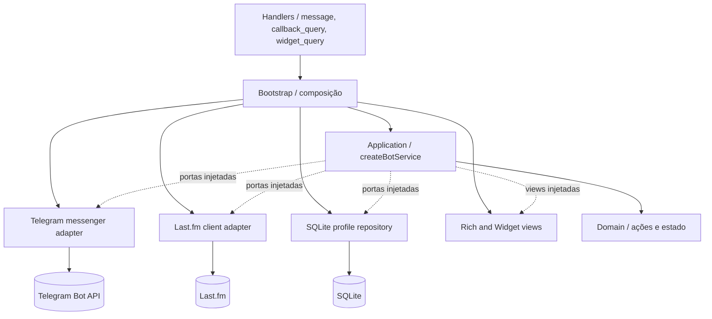

# Arquitetura de código — widgettrobot 2.0.4

## Objetivo

Eliminar dependências diretas dos handlers e casos de uso sobre Bot API, API HTTP e SQLite, sem criar uma rede excessiva de serviços.

## Diagrama de dependências



A seta pontilhada significa uma chamada através de uma interface implícita (duck typing), e não um `import` do adaptador. O **bootstrap** é a raiz de composição, o único ponto que liga tudo.

## Portas da aplicação

```js
profiles = {
  get(telegramId),
  save(telegramId, lastfmUsername),
  remove(telegramId),
};
lastfm = { recent(username, limit) }; // retorna uma lista de tracks normalizadas
messenger = {
  rich(chatId, view),
  widget(chatId, { html, caption, data }),
  callbackAnswer(callbackId, optionalText),
  widgetAnswer(widgetQueryId, data),
  widgetUpdate(chatId, messageId, data),
};
views = { welcome(user), profile(user), current(state), recent(user, tracks),
  error(title, detail), linked(user), unlinkHelp(), unlinked() };
```

Os métodos de apresentação retornam apenas HTML; não há `fallbackHtml` que mascare erros de envio. Apenas o adaptador do Telegram chama `api.sendRichMessage`, `api.sendWidget` e os demais métodos.

## Fluxos

### Usuário associa Last.fm

1. `handlers/message.js` delega ao bot.
2. A aplicação chama `parseMessage` e `validateUsername` do domínio.
3. Chama a porta `lastfm.recent` para validar que a API responde para o usuário.
4. Chama `profiles.save`.
5. Produz `views.linked` e envia pela porta `messenger.rich`.

### Atualizar Widget

1. `handlers/widget_query.js` delega à aplicação.
2. O domínio mapeia `refresh` para ação permitida; a aplicação valida chat e usuário.
3. O bot envia **primeiro** `answerWidgetQuery({ data: "{\"ok\":true,\"status\":\"accepted\"}" })`, cumprindo o prazo de 15 segundos.
4. A aplicação carrega o perfil por `profiles.get` e as faixas por `lastfm.recent`; falhas criam estado `error`.
5. `domain/lastfm-parser.js` converte para `compactState`, respeitando o limite de 1024 bytes.
6. `editMessageWidgetData` altera o estado no chat. O evento `chatDataChanged` confirma a atualização na interface; a resposta inicial não é tratada como sucesso final.
7. Se o SDK recusar a edição, a falha é registrada com `code` e `retry_after`, propagada ao runtime, e o Widget informa ausência de confirmação se não receber novos dados.

## Onde cada mudança deve acontecer

| Desejo | Arquivo |
|---|---|
| Novo provedor de música | `lib/infrastructure/novo-client.js` e `lib/bootstrap.js` |
| Novo banco | `lib/infrastructure/novo-repository.js` e `lib/bootstrap.js` |
| Outro layout Rich | `lib/presentation/rich.js` |
| Alterar CSS/JS do Widget | `lib/presentation/widget.js` |
| Novo comando | `lib/domain/actions.js` + `lib/application/bot-service.js` |
| Autorização de novas ações | `lib/application/bot-service.js` |
| Novos métodos Telegram | `lib/infrastructure/telegram-messenger.js` |
| Deploy/CI | `.github/workflows/deploy.yml` |

## Regras e decisões

- **Sem import de SDK no domínio, aplicação ou apresentação.** Essa separação é uma decisão de projeto; o script de validação não depende de leitura de nomes e símbolos internos para verificá-la.
- **Sem chaves na apresentação.** Segredos ficam apenas no backend e o Last.fm é acessado pelo cliente HTTP injetado.
- **Handlers com uma responsabilidade.** Receber evento Telegram e repassar ao serviço.
- **Sem estruturas desnecessárias.** Mantemos JavaScript puro, sem contêiner de DI nem microserviços.
- **Esquema SQL estável.** Não há alteração de tabela nesta refatoração; não exige migração de dados.
- **Limite do Widget validado no build e em fluxos.** `npm run check` mede o HTML e sua compressão; os testes exercitam estados UTF-8 enviados pelo Widget e respostas ao Telegram.
- **Estado não é segredo.** O nome Last.fm é público; não adicione informações confidenciais ao `chat_data`.

## Validação

```bash
npm test        # contrato HTTP Last.fm, mensagens Telegram, permissões e falhas reais simuladas
npm run check   # sintaxe, integridade de imports, tamanho e segurança básica do Widget
```

A verificação de deploy real só pode ser feita em um bot com Telegram Serverless ativado e Secrets válidos.

## Erros da API e política de falhas

Consulte [`API_E_ERROS.md`](./API_E_ERROS.md). O domínio agora inclui `domain/errors.js`, que classifica códigos oficiais Last.fm e normaliza a forma documentada de `BotApiError`. Os adaptadores não fabricam respostas de sucesso quando há falha de rede, persistência ou Telegram.
